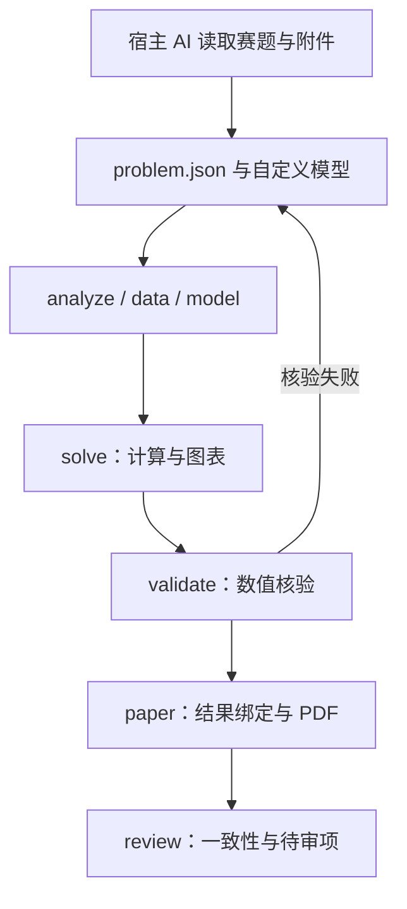

# 架构与数据契约

八个 skills 描述决策流程；Python 运行器实现有限且明确的产物协议。相邻 skill 可以共享同一工作区，宿主决定采用哪些步骤。运行器不依赖特定模型 API、API key 或多代理框架。

schemas/ 提供 problem、solution 和论文内容的编辑器 JSON Schema。运行时还会检查依赖环、路径边界、单位、时间连续性等跨字段条件；Schema 本身不代表语义正确性。

## 输入签名

输入指纹由 problem.json、主 data_file、所有 raw/ 文件、input_files、statement.md、adapter.py、运行器源码和依赖版本共同构成。每个阶段再合并上游签名；paper/review 额外合并正文、模板、PDF 引擎和实际 AI 使用记录。

同一输入且产物哈希一致时命中缓存。某阶段重建后，下游先标 stale，再逐步完成。计算失败留下 failed 和错误信息；过去的文件可用于对比，但不会被标为当前完成。新增原始附件也触发失效。为保证正确性，源码和运行依赖变化采用保守的全链失效策略。

state.json 的每个阶段包含 status、signature、时间和 outputs 的 SHA-256。JSON 关键产物采用同目录临时文件原子替换。一个工作区同一时间由一个进程写入；不同工作区可并行。当前版本没有同工作区多写者锁和协作合并。

## 小问和结果

questions 构成有向无环依赖图。内置适配器只允许其支持的 task。自定义适配器负责实际实现多问依赖，并在 coverage 中标记已计算任务；该映射仍需宿主对照原题审阅。

solution 包括 status、metrics、tables、coverage、result_id、input_signature。未得到的数值用 null；禁止 NaN/Infinity。validate 返回非空 checks，运行器重新计算总体通过状态。自动检查通过后才构建论文。

## 论文证据

content.json 的 metric/value/param/cite 标记绑定结构化来源，claims.json 保存原值和格式。review 对照当前输入签名、结果、绑定正文及产物哈希检查。paper.build.json 记录引擎、页数、draft 和待人工核验来源。

审阅报告只覆盖已编码规则；不将自动数值一致性、任意适配器的自报覆盖或自报验证当作科学正确性证明。最终语义检查由宿主和队员完成。
