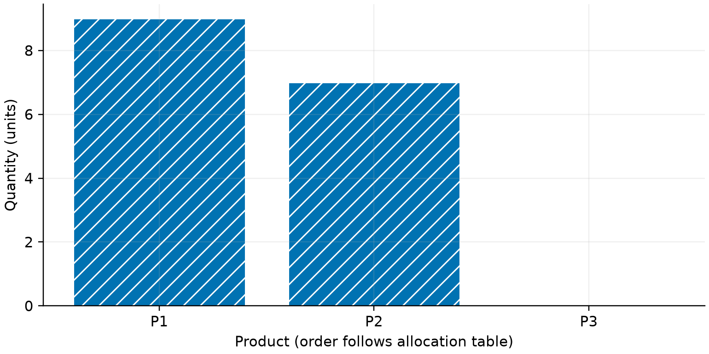
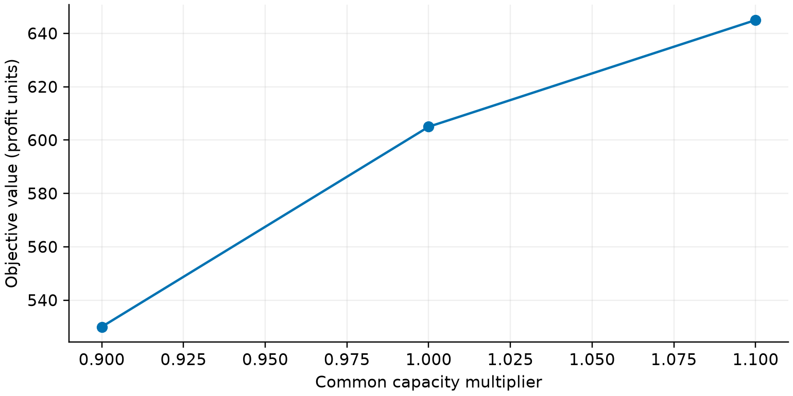

# 有限资源下的整数生产配置与容量情景分析

> 训练论文草稿 · 计算已核验，模型解释与引用待队员审阅。

## 摘要

针对有限工时与材料下的生产配置问题，建立带产量上下界的整数线性规划模型，并设置可行贪心方案作为比较基线。本次求解得到总利润 605.00，基线总利润为 515.00，相对变化为 17.48%。通过逐项约束复算、线性松弛上界和小规模枚举交叉检验验证主方案，并比较资源同步变化的情景。结论限于已声明的教学数据与线性假设。

关键词：整数规划；资源配置；敏感性分析；可复现计算

## 题目要求与数据来源

本案例使用人工构造的教学数据，用于验证建模、代码与论文的一体化流程；不是企业实测数据，也不是历年赛题附件。

- Q1：在资源和产量上限约束下，确定使总利润最大的整数生产方案。

- Q2：分析资源容量同步下降和上升时的方案目标值，并讨论适用边界。

## 建模假设

- 每种产品的单位利润、工时和材料消耗在本次决策期内保持不变。

- 产品数量为非负整数，产量上限由附件给定，未销售风险未计入。

- 情景分析中全部资源容量按同一比例变化，其余参数保持不变。

## 模型表述

决策变量是整数，目标和资源约束均线性；使用 MILP 并与线性松弛上界比较。

$$ \max\; z=\sum_{j=1}^{n}p_jx_j $$

$$ \sum_{j=1}^{n}a_{ij}x_j\leq b_i\quad(i=1,\ldots,m) $$

$$ l_j\leq x_j\leq u_j,\quad x_j\in\mathbb{Z}_{\geq0} $$

## 主方案与基线比较

以产品数量为决策变量，使用混合整数线性规划求解器完成优化[scipy_milp]。主方案总利润为 605.00，贪心基线为 515.00，相对变化为 17.48%。线性松弛上界为 605.00。具体产品数量列于配置表；最优性表述以求解状态和交叉核验记录为依据。

## 容量情景与决策解释

分别对资源容量实施同步收缩与扩张并重新求解，具体目标值和状态列于情景表。该实验反映给定方向上的局部响应，整数生产数量可能导致目标值随容量呈现阶梯变化。资源类别的边际价值需要分别扰动后进一步分析。

## 数据表：生产配置方案

| 产品 | 数量 | 利润 |

|---|---|---|

| 产品甲 | 9 | 360 |

| 产品乙 | 7 | 245 |

| 产品丙 | 0 | 0 |

## 数据表：资源容量情景

| 容量倍率 | 求解状态 | 目标值 |

|---|---|---|

| 0.9 | 最优 | 530 |

| 1 | 最优 | 605 |

| 1.1 | 最优 | 645 |

## 局限性

- 利润与资源消耗视为常数，未包含价格反馈。

- 情景扰动属于局部分析，不代表随机鲁棒最优。

## 参考来源

- [scipy_milp] SciPy 官方文档：混合整数线性规划 milp — https://docs.scipy.org/doc/scipy/reference/generated/scipy.optimize.milp.html；核验状态：opened_by_agent

## 复现与使用说明

在工作区所在项目中执行 `mm run <工作区> --force`，重新计算并构建论文。

本文使用项目内声明的训练数据，不应将演示结论直接解释为实际业务结论。

结果记录：47db080aee5d5c7f。实际 AI 使用记录见 ai_usage.jsonl；作者需据实补充人工修改和核验过程。
