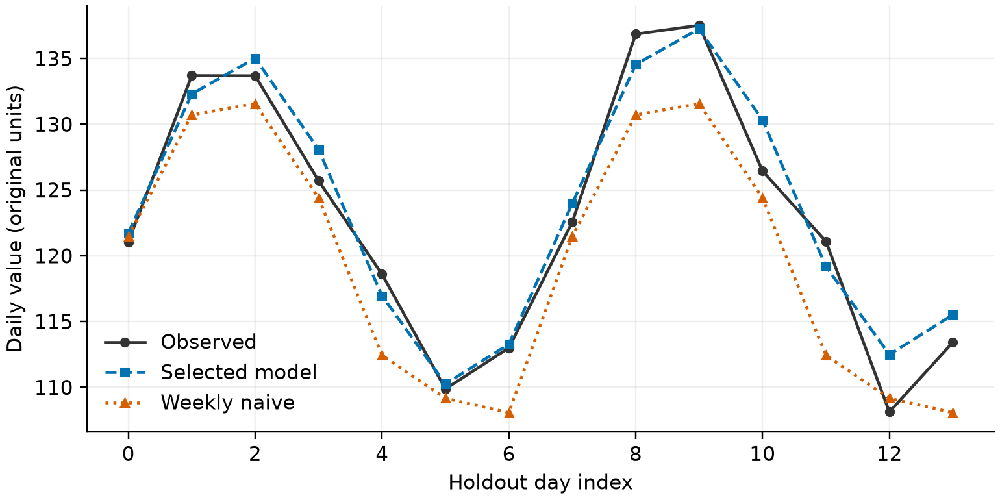
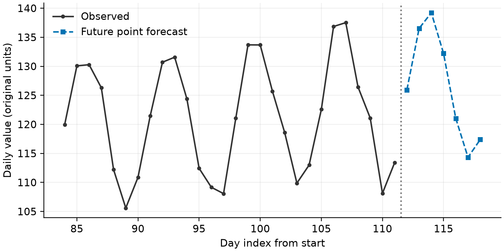

# 基于时间顺序验证的日需求预测与基线比较

> 训练论文草稿 · 计算已核验，模型解释与引用待队员审阅。

## 摘要

针对日需求预测问题，使用 112 个连续日观测，设置最终留出测试集，并仅在测试集之前的数据上开展扩展窗口验证。训练期比较后选定 趋势与周周期模型 模型。最终测试均方根误差为 2.108，周朴素基线为 4.321，相对变化为 51.21%。之后用全部观测重新拟合，未来预测期合计需求为 886.64。结果为点预测，其适用范围限于教学数据及已声明假设。

关键词：时间顺序验证；需求预测；周周期；基线比较

## 题目要求与数据来源

本案例数据由固定随机种子的趋势、周周期和随机扰动构造，仅用于教学与软件评测；生成程序保存在 generate_data.py。

- Q1：比较周朴素、线性趋势、趋势加周周期模型，并用训练期验证选择方法。

- Q2：在留出测试集评价预测误差，再用全部已观测数据拟合并预测未来需求。

## 建模假设

- 日需求具有可由候选模型近似的趋势或周周期。

- 观测日期连续且单位一致，预测时只能使用预测起点之前已知的信息。

- 当前候选模型未纳入节假日、价格与结构突变等外部因素。

## 模型表述

仅在最终测试集之前的数据上进行扩展窗口验证，按平均 RMSE 选择模型；测试集只评价一次。

$$ \widehat y_t=\beta_0+\beta_1t $$

$$ \widehat y_t=\beta_0+\beta_1t+\beta_2\sin(2\pi t/7)+\beta_3\cos(2\pi t/7) $$

$$ \operatorname{RMSE}=\sqrt{N^{-1}\sum_t(y_t-\widehat y_t)^2} $$

## 候选模型与训练期选择

候选方法包含同星期朴素模型、线性趋势模型及趋势加周周期模型。参数通过最小二乘估计[numpy_lstsq]。所有验证窗口均位于最终测试期之前；根据训练期平均验证误差选定 趋势与周周期模型，比较结果列于模型表。最终测试集不参与候选方法选择。

## 独立测试与未来预测

最终留出样本数为 14，所选方法的均方根误差为 2.108，平均绝对误差为 1.737。周朴素基线的均方根误差为 4.321，相对变化为 51.21%。完成评价后，使用全部已观测数据重新拟合，未来预测期合计需求为 886.64。预测结果没有附加未经校准的置信区间。

## 数据表：留出测试集逐日比较

| 日期 | 观测值 | 预测值 | 基线值 |

|---|---|---|---|

| 2026-04-09 | 121.05 | 121.74 | 121.47 |

| 2026-04-10 | 133.69 | 132.3 | 130.7 |

| 2026-04-11 | 133.68 | 135.02 | 131.57 |

| 2026-04-12 | 125.7 | 128.08 | 124.39 |

| 2026-04-13 | 118.6 | 116.95 | 112.43 |

| 2026-04-14 | 109.88 | 110.26 | 109.17 |

| 2026-04-15 | 113 | 113.28 | 108.07 |

| 2026-04-16 | 122.57 | 123.97 | 121.47 |

| 2026-04-17 | 136.85 | 134.54 | 130.7 |

| 2026-04-18 | 137.52 | 137.25 | 131.57 |

| 2026-04-19 | 126.44 | 130.31 | 124.39 |

| 2026-04-20 | 121.09 | 119.19 | 112.43 |

| 2026-04-21 | 108.13 | 112.49 | 109.17 |

| 2026-04-22 | 113.42 | 115.51 | 108.07 |

## 数据表：未来逐日点预测

| 日期 | 预测值 |

|---|---|

| 2026-04-23 | 125.94 |

| 2026-04-24 | 136.53 |

| 2026-04-25 | 139.22 |

| 2026-04-26 | 132.21 |

| 2026-04-27 | 121.03 |

| 2026-04-28 | 114.32 |

| 2026-04-29 | 117.38 |

## 数据表：训练期扩展窗口比较

| 候选模型 | 验证 RMSE |

|---|---|

| 周朴素模型 | 5.3841 |

| 线性趋势模型 | 10.103 |

| 趋势与周周期模型 | 2.8878 |

## 局限性

- 候选模型仅含周周期和线性趋势，结构突变会影响外推。

- 结果是点预测；本案例未估计经校准的预测区间。

## 参考来源

- [numpy_lstsq] NumPy 官方文档：最小二乘求解 numpy.linalg.lstsq — https://numpy.org/doc/stable/reference/generated/numpy.linalg.lstsq.html；核验状态：opened_by_agent

## 复现与使用说明

在工作区所在项目中执行 `mm run <工作区> --force`，重新计算并构建论文。

本文使用项目内声明的训练数据，不应将演示结论直接解释为实际业务结论。

结果记录：8a7cedf5652865f1。实际 AI 使用记录见 ai_usage.jsonl；作者需据实补充人工修改和核验过程。
