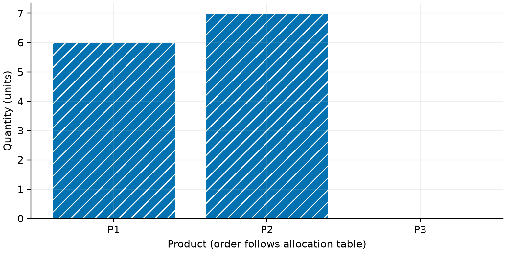
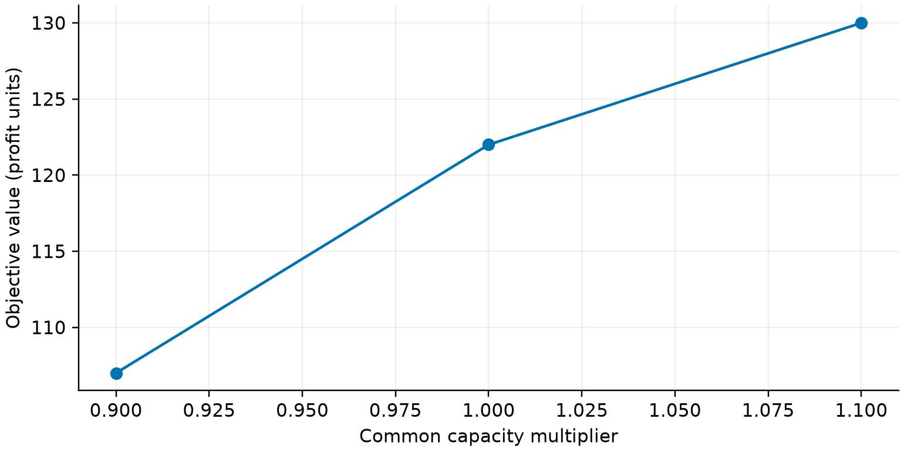

# 训练工坊的整数生产配置与资源情景分析

> 训练论文草稿 · 计算已核验，模型解释与引用待队员审阅。

## 摘要

针对训练工坊的生产配置任务，建立满足最低与最高产量要求的整数线性规划模型。原始机时容量为 19，材料容量为 21。实际求解利润为 122.00，可行贪心基线利润为 103.00，相对变化为 18.45%。通过约束复算和整数域枚举核验主方案，并比较资源同步变化的情景。结论限于题目声明的人工构造数据。

关键词：整数生产配置；容量约束；枚举核验；情景分析

## 题目要求与数据来源

用户提供的生产配置训练任务及 products.csv，原题明确数据为人工构造；不代表实际企业测量。

- Q1：按附件最低与最高产量约束给出利润最大的整数生产方案，并与可行基线比较。

- Q2：比较资源容量同步收缩或扩张时的目标变化。

## 建模假设

- 决策期内各产品的单位利润与单位资源消耗固定。

- 产品按整件生产，最低与最高产量均按原始附件严格约束。

- 情景分析只同步改变资源容量，其余参数保持不变。

## 模型表述

决策变量是整数，目标和资源约束均线性；使用 MILP 并与线性松弛上界比较。

$$ \max\; z=\sum_{j=1}^{n}p_jx_j $$

$$ \sum_{j=1}^{n}a_{ij}x_j\leq b_i\quad(i=1,\ldots,m) $$

$$ l_j\leq x_j\leq u_j,\quad x_j\in\mathbb{Z}_{\geq0} $$

## 主方案与约束解释

依据附件的利润、资源消耗和产量边界建立模型。原题要求产品按整件生产，且训练品A对应的最低生产数量必须保留。使用 SciPy 的混合整数规划求解接口[scipy_milp]，得到目标值 122.00；线性松弛上界为 123.67。可行贪心基线目标值为 103.00，相对变化为 18.45%。各产品的具体配置数量见结果表。求解状态与数值核验共同作为最优性表述依据。

## 容量情景与局限

对两类资源容量实施同步比例扰动，逐个重新求解并保留状态，具体数值见情景表。由于整数产量约束，增加容量的效益可能存在台阶。本次同步扰动不等价于每类资源的独立边际价值分析；实际业务解释还需要核验利润和资源消耗的稳定性。

## 数据表：生产配置方案

| 产品 | 数量 | 利润 |

|---|---|---|

| 训练品A | 6 | 66 |

| 训练品B | 7 | 56 |

| 训练品C | 0 | 0 |

## 数据表：资源容量情景

| 容量倍率 | 求解状态 | 目标值 |

|---|---|---|

| 0.9 | 最优 | 107 |

| 1 | 最优 | 122 |

| 1.1 | 最优 | 130 |

## 局限性

- 利润与资源消耗视为常数，未包含价格反馈。

- 情景扰动属于局部分析，不代表随机鲁棒最优。

## 参考来源

- [scipy_milp] SciPy 官方文档：混合整数线性规划 milp — https://docs.scipy.org/doc/scipy/reference/generated/scipy.optimize.milp.html；核验状态：opened_by_agent

## 复现与使用说明

在工作区所在项目中执行 `mm run <工作区> --force`，重新计算并构建论文。

本文使用项目内声明的训练数据，不应将演示结论直接解释为实际业务结论。

结果记录：83ec2d499ded44ef。实际 AI 使用记录见 ai_usage.jsonl；作者需据实补充人工修改和核验过程。
